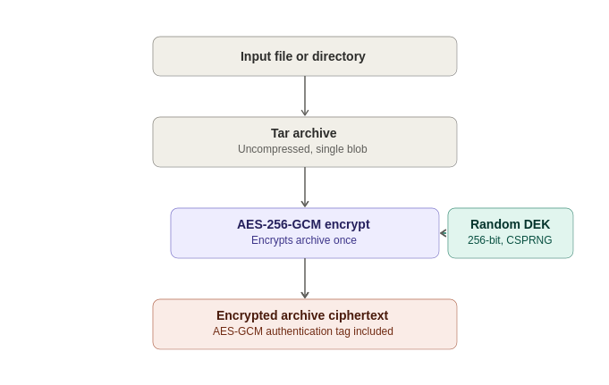
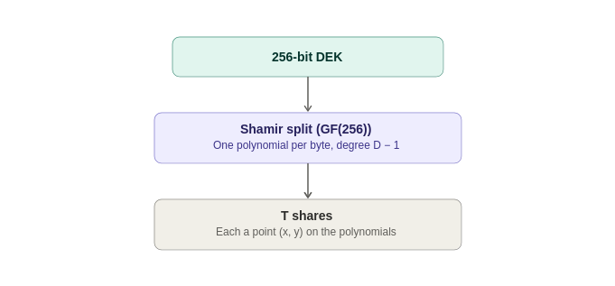
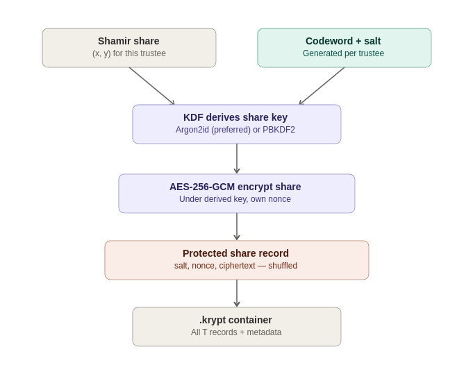
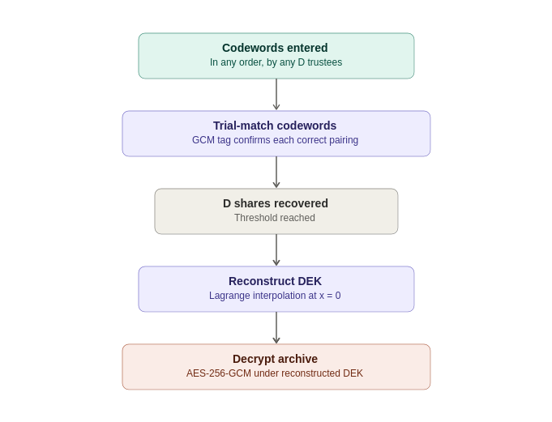
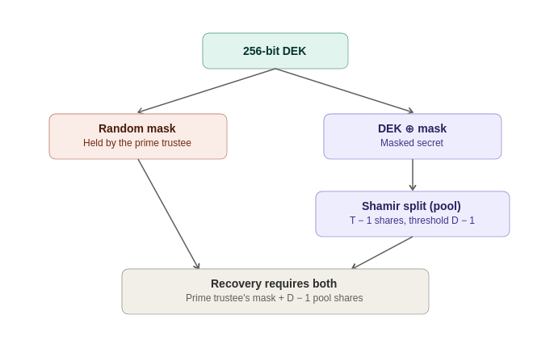

**SHARDIC**

Sharded Encryption for Threshold-Recoverable Encrypted Vaults

*Enforcing Multi-Person Integrity for High-Stakes Data Recovery*

**White Paper**

July 2026

Project repository: github.com/splashd1/shardic

Table of Contents

[Abstract 3](#abstract)

[1. The Need for Threshold-Recoverable Encryption 4](#the-need-for-threshold-recoverable-encryption)

[1.1 Conventional Data Encryption: Monolithic, Single-Point Control 4](#conventional-data-encryption-monolithic-single-point-control)

[1.2 Sharded Encryption: Enforcing Multi-Person Integrity 4](#sharded-encryption-enforcing-multi-person-integrity)

[1.3 Representative Use Cases 5](#representative-use-cases)

[Break-glass access to critical infrastructure 5](#break-glass-access-to-critical-infrastructure)

[Diceware-style estate and succession planning 5](#diceware-style-estate-and-succession-planning)

[Government and public-sector applications 6](#government-and-public-sector-applications)

[Business and regulated-industry applications 6](#business-and-regulated-industry-applications)

[2. Concept of Operations 7](#concept-of-operations)

[2.1 Operator Walkthrough: Creating a Vault 7](#operator-walkthrough-creating-a-vault)

[2.2 Operator Walkthrough: Recovering a Vault 8](#operator-walkthrough-recovering-a-vault)

[2.3 shardic-prime: A Mandatory-Trustee Variant 9](#shardic-prime-a-mandatory-trustee-variant)

[3. Technical Mechanics 10](#technical-mechanics)

[3.1 Archive and Data Encryption Key 10](#archive-and-data-encryption-key)

[3.2 Shamir's Secret Sharing over GF(256) 11](#shamirs-secret-sharing-over-gf256)

[3.3 Codeword-Derived Key Protection of Shares 12](#codeword-derived-key-protection-of-shares)

[3.4 The .krypt Container and Zero-Leakage Indexing 13](#the-.krypt-container-and-zero-leakage-indexing)

[3.5 How shardic-prime Varies 14](#how-shardic-prime-varies)

[3.6 A Proposed Extension: Public-Key-Wrapped Codewords (shardic-envelope) 15](#a-proposed-extension-public-key-wrapped-codewords-shardic-envelope)

[4. Security Discussion 17](#security-discussion)

[4.1 Two Different Kinds of Strength: Key Length vs. Trustee Threshold 17](#two-different-kinds-of-strength-key-length-vs.-trustee-threshold)

[4.2 Codeword Modes: Security and Usability Trade-offs 17](#codeword-modes-security-and-usability-trade-offs)

[Memorable mode (default) 17](#memorable-mode-default)

[Dictionary mode 18](#dictionary-mode)

[Synthetic mode 18](#synthetic-mode)

[4.3 Tuning Options 18](#tuning-options)

[4.4 Impact of shardic-envelope: Security, Use-Case, and Operational Considerations 19](#impact-of-shardic-envelope-security-use-case-and-operational-considerations)

[Security impact on protection 19](#security-impact-on-protection)

[Use-case impact for adoption 20](#use-case-impact-for-adoption)

[Other operational impacts 20](#other-operational-impacts)

[5. Summary 22](#summary)

[5.1 What Sets This Apart From Conventional Symmetric Encryption 22](#what-sets-this-apart-from-conventional-symmetric-encryption)

[5.2 Advantages 22](#advantages)

[5.3 Limitations and Mitigations 23](#limitations-and-mitigations)

# Abstract

Conventional file encryption is monolithic: whoever holds the key, or controls the system that holds it, controls access to the plaintext — permanently and unilaterally. **shardic** replaces that single point of control with a **threshold-recoverable** model. A file or directory is encrypted once under a randomly generated data encryption key (DEK), and that DEK is then split — using Shamir's Secret Sharing over GF(256) — into T shares distributed to T independent trustees. No fewer than a threshold of D trustees, each supplying an individually held codeword, can ever reconstruct the key. Below that threshold, the remaining shares carry *zero* information about the key — a guarantee that holds regardless of computing power, not merely one that is expensive to break. This paper describes the operational need for that guarantee, walks through the tool from an operator's perspective, documents the underlying cryptographic mechanics, and discusses the security properties and trade-offs of the design.

## 1. The Need for Threshold-Recoverable Encryption

## 1.1 Conventional Data Encryption: Monolithic, Single-Point Control

The standard model of symmetric encryption is simple: a key is generated, data is encrypted under it, and the key is stored or shared so that plaintext can later be recovered from the ciphertext. That simplicity is also the model's structural weakness. Whoever possesses the key — a person, a process, a single server — has **complete and unilateral** power over the data it protects. Access is a binary, anonymous fact: either you hold the key, or you don't. There is no way, within the cryptography itself, to require that access be a *joint* decision, or to prove after the fact who authorized a given recovery.

This single-point-of-control property persists even when the key management around it becomes more sophisticated. Wrapping a symmetric key with a public key so it can only be unwrapped by whoever holds the matching private key changes *who* the single point of control is, but not *that* there is one — the private key becomes the new monolithic secret. Locking a key inside an HSM, a safe, or a physically secured server changes *where* the single point of control lives, but a single compromised operator, a single coerced administrator, or a single stolen credential is still sufficient to defeat it. None of these supplements change the underlying shape of the trust model: one secret, one holder, one point of failure.

For routine data protection this is an acceptable, even desirable, trade-off — simplicity and low friction usually outweigh the risk. It becomes a liability precisely in the cases organizations care about most: root credentials, master keys, and archives whose disclosure or misuse by a single rogue, insider threat, or compromised party would be catastrophic.

## 1.2 Sharded Encryption: Enforcing Multi-Person Integrity

Sharded, threshold-recoverable encryption addresses this by removing the single point of control from the cryptography itself, rather than relying on policy or process to compensate for it. Instead of one key held by one party, the key is mathematically split into T pieces ("shares"), distributed to T independent trustees, with a threshold D set below T. Recovering the plaintext requires at least D trustees to each independently choose to participate. Critically, this is not merely operationally enforced (e.g. by requiring D signatures at an application layer) — it is **information-theoretically enforced**: with the underlying Shamir's Secret Sharing construction, any collection of fewer than D shares carries mathematically zero information about the key, no matter how much computing power is applied against it.

The practical effect is that:

- No single trustee — including whoever originally created the vault — can ever recover the data alone.

- A rogue insider, a coerced employee, or a single compromised account is insufficient to cause disclosure; a collusion of at least D independent parties is required.

- The trustee pool can absorb the loss or unavailability of up to T − D trustees without losing recoverability — unlike a strict N-of-N or two-person rule, which has no slack.

- Every recovery event has a natural audit trail: the specific set of trustees who each chose to supply a codeword.

This shifts data protection from "who holds the key" — a fact about custody — to "who agreed to unlock it" — a fact about consent, distributed across independent parties who cannot individually override the group.

## 1.3 Representative Use Cases

Threshold-recoverable encryption is the right tool wherever policy, regulation, or risk tolerance already implies that no single party should be able to unilaterally decrypt something, and where access is rare and high-stakes rather than continuous and routine. Representative examples include:

#### Break-glass access to critical infrastructure

A root certificate-authority private key, a production database master key, or a SCADA override credential is locked in a vault with, say, T=7 trustees — a mix of senior engineers, security officers, and an executive — and a D=4 threshold. Day to day, *nobody* has access to the key at all. It is reconstructed only for a genuine emergency, and only if four of the seven trustees each independently agree to participate.

#### Diceware-style estate and succession planning

A family or founder splits access to a password manager's master vault, or other key-person credentials, among relatives, a lawyer, and a business partner (T=5, D=3), using memorable, whole-word codewords that trustees can actually commit to memory rather than write down.

#### Government and public-sector applications

- Generalized two-person-rule systems ("any 3 of 7 officials") that tolerate absence or incapacitation without weakening the no-lone-actor requirement of the classic two-key model.

- Escrowed decryption keys for classified or lawful-intercept archives, split across officials from different branches or agencies so that no single agency — or a rogue insider within one — can unilaterally decrypt.

- Continuity-of-government credentials that must survive the loss of some custodians while still requiring majority agreement to invoke.

- Election-system tabulation keys split among representatives of multiple parties or observers.

#### Business and regulated-industry applications

- M&A escrow and dispute-resolution vaults — deal terms or sensitive documents released only by quorum of board members, outside counsel, and an escrow agent.

- Cryptocurrency or treasury cold storage — splitting root key material behind a multisig wallet among founders or board members so no single executive can move funds alone.

- Whistleblower or source-protection archives, releasable only if a threshold of editors or lawyers agree.

- Regulated data with explicit separation-of-duties requirements (e.g. SOX, HIPAA “minimum necessary” contexts) — a technical enforcement of an existing compliance control rather than a policy statement alone.

*Where this approach fits best:* rare, high-stakes, offline “break-glass” access with a small, semi-static trustee set, where the vault file itself must be safely storable and shareable without leaking metadata about who holds what. It is a poor fit for frequent or live authorization, for revoking a single trustee without a full re-split, or for online multi-party protocols — those are better served by threshold-signature schemes (e.g. FROST) or HSM-backed multisig, which support key rotation and live quorum that this static, split-once design does not attempt to provide.

# 2. Concept of Operations

This section walks through the tool exactly as an operator experiences it: first the encryption (vault creation) sequence, then the decryption (recovery) sequence, using the command-line interface. The GUI exposes the same two operations through the same underlying library, so the sequence of decisions is identical — only the interaction surface changes.

## 2.1 Operator Walkthrough: Creating a Vault

An operator with a directory of sensitive files decides on two numbers before doing anything else: how many trustees (T) will hold a codeword, and how many of them (D) must agree to recover the data. In this walkthrough, five trustees are established with a threshold of three:

```
$ python3 vault_create.py \
    --input ./secret_docs \
    --trustees 5 --threshold 3 \
    --word-count 3
```

Left at its defaults, the tool:

1.  Reports which key-derivation function will protect each share (Argon2id if available, otherwise PBKDF2), since this affects recovery speed and offline-guessing resistance.

2.  Defaults to --memorable mode when no fixed word length is given, drawing codewords from the bundled EFF long wordlist rather than synthetic strings.

3.  Reports its own combinatorial strength estimate for a single trustee's codeword phrase, so the operator can judge — before distributing anything — whether the chosen word count is adequate for the stakes involved.

4.  Archives the input into a single blob, generates a random 256-bit data encryption key, and encrypts the archive under it.

5.  Splits that key into the requested number of Shamir shares and protects each one under its own randomly generated codeword.

6.  Writes one self-contained .krypt file, plus one text file per trustee containing only that trustee's codeword.

The actual output of the run above:

```
[i] Share protection KDF: pbkdf2 {'iterations': 400000}
[i] No --word-length given: defaulting to --memorable mode
(whole real words).
[*] Memorable mode: loaded 7772 whole, real candidate words
from the bundled EFF wordlist
[*] Estimated codeword strength: ~39 bits combinatorial per
trustee (before any KDF stretching). Recovery cracks each
codeword independently, so this per-codeword number -- not
a 5-trustee total -- is the real security margin; raising
threshold/trustee counts does not substitute for it.
[*] Archiving 'secret_docs' ...
[*] Split DEK into 5 shares, threshold 3
[*] Wrote vault container: vault_out/ce28by1pn9z8wib2.krypt
(11388 bytes)
[+] Wrote 5 trustee codeword files to: vault_out/trustee_words/
Distribute each trustee_N.txt to exactly one trustee (out
of band, e.g. in person or over a channel they
individually control), then DELETE these files from this
machine. Recovery needs only the single .krypt file + any
3 of the 5 codewords.
```

The operator's remaining job at this point is entirely procedural, not cryptographic: distribute each trustee_N.txt to exactly one trustee, out of band, over a channel that trustee individually controls — and then delete the local copies. The tool deliberately does not automate distribution; who receives which codeword, and how, is a trust decision that belongs to the operator, not the software.

## 2.2 Operator Walkthrough: Recovering a Vault

At recovery time, any three of the five trustees supply their codewords — the operator does not need to know or specify which three:

```
$ python3 vault_recover.py vault_out/ce28by1pn9z8wib2.krypt \
    --word "broadside-repulsion-subway" \
    --word "valuables-repeater-oversleep" \
    --word "winking-portly-diffusion"
```

Actual output:

```
[i] This vault requires 3 of 5 codewords to recover.
[i] Share protection KDF: pbkdf2
[+] Codeword accepted (1/3).
[+] Codeword accepted (2/3).
[+] Codeword accepted (3/3).
[*] Reconstructing DEK from recovered shares ...
[*] Decrypting archive ...
[*] Success. Recovered contents extracted to:
/tmp/wp_demo/recovered_out
```

Two operational details are worth calling out. First, codewords can be entered in **any order** — recovery does not ask “which trustee are you,” it simply tries each supplied codeword against every not-yet-matched share until one authenticates (see §3.4). Second, if fewer than D codewords match, or any of them are wrong, the tool reports how many were accepted and stops — it never writes partial or best-guess output.

## 2.3 shardic-prime: A Mandatory-Trustee Variant

The base scheme treats every trustee identically — any D of T codewords recover the vault, full stop. **shardic-prime** is a separate variant, with its own CLI tools and its own container format, that adds one *essential* trustee on top of the base scheme: the **prime trustee's** codeword must always be among those supplied, no matter how many other codewords are gathered. The remaining trustees form an ordinary interchangeable pool for the rest of the threshold.

This fits situations where one specific role — an estate's executor, an organization's security lead — must always sign off, while the people backing them up can be any qualifying subset. In T=4, D=3 prime-trustee terms, that means 1 prime trustee plus 3 pool trustees, and recovery needs the prime's codeword plus any 2 of the 3 pool codewords:

```
$ python3 vault_create_prime.py --input ./my_directory \
    --trustees 4 --threshold 3 \
    --word-length 6 --word-count 2
$ python3 vault_recover_prime.py VAULT.krypt
```

All three pool codewords, gathered without the prime trustee's, recover nothing — a property guaranteed by the construction itself (§3.5), not merely enforced by the CLI. As with the base scheme, recovery does not require the operator to say in advance which supplied codeword belongs to the prime trustee; it is identified automatically once decryption succeeds.

# 3. Technical Mechanics

This section describes how the .krypt container actually protects data: how the data encryption key is generated, how Shamir's Secret Sharing protects its recovery, and how each individual share is, in turn, protected by a codeword-derived key.

## 3.1 Archive and Data Encryption Key

Vault creation proceeds in a fixed sequence:

1.  The input file or directory is bundled with tar into a single blob, so any input shape — one file or an entire directory tree — is handled uniformly. The archive is deliberately left uncompressed (mode "w", not "w:gz") so ciphertext size does not vary with plaintext compressibility any more than strictly necessary — compression can otherwise leak information about content through size alone.

2.  A random 256-bit data encryption key (DEK) is generated using a cryptographically secure random source (secrets.token_bytes).

3.  The archive is encrypted exactly once, under that DEK, using AES-256-GCM with a randomly generated 96-bit nonce. GCM provides both confidentiality and built-in tamper detection: any modification to the ciphertext causes authentication to fail rather than silently decrypting to garbage.

At this point, the DEK is the single piece of secret material standing between the ciphertext and the plaintext — exactly as in conventional symmetric encryption. What differs from the conventional model is what happens to that key next.



## 3.2 Shamir's Secret Sharing over GF(256)

Rather than being stored or handed to a single custodian, the DEK is split using a byte-wise implementation of Shamir's Secret Sharing (SSS) over the finite field GF(2⁸) — the same construction used by classic tools such as ssss, and the same field arithmetic AES itself uses (generator 3, reduction polynomial 0x11B).

The construction, applied independently to each of the DEK's 32 bytes:

- Each byte of the secret becomes the constant term of a random polynomial of degree D − 1, with the remaining coefficients drawn uniformly at random.

- Each of the T shares is that polynomial evaluated at a distinct x-coordinate (1 through T), across all 32 byte positions simultaneously.

- Reconstruction takes any D shares and applies Lagrange interpolation at x = 0, independently per byte position, to recover the original secret byte.

> **Why this is information-theoretic, not merely computational**
>
> A polynomial of degree D − 1 is uniquely determined by any D points on it — but with only D − 1 points, *every* possible value of the constant term (the secret byte) remains equally consistent with those points. An attacker holding D − 1 shares therefore learns exactly zero bits about the DEK, regardless of computing power, time, or future cryptanalytic advances against AES itself. This is the property that separates threshold recovery from key-splitting schemes built on secret-sharing-flavored encryption tricks that are only computationally, not information-theoretically, hard to break below threshold. "Information-theoretic" security means a guarantee that holds regardless of computing power — not because breaking it is *hard*, but because the information needed to break it simply isn't *there*.



## 3.3 Codeword-Derived Key Protection of Shares

A raw Shamir share is still just data — if written to disk unprotected, whoever possesses D of them could reconstruct the DEK without any trustee's cooperation at all. Each share is therefore itself individually encrypted before being placed in the vault:

1.  A random, human-typeable codeword is generated for the share (see §4.2 for the available modes: memorable, dictionary, and synthetic).

2.  A random salt is generated, and a 256-bit key is derived from the codeword and salt using one of two supported key-derivation functions: PBKDF2-HMAC-SHA256 (400,000 iterations by default — a zero-extra-dependency baseline) or Argon2id (time_cost=4, memory_cost=256 MiB, parallelism=4 by default — memory-hard, and preferred when the optional argon2-cffi package is available, since memory-hardness raises the cost of large-scale parallel GPU/ASIC guessing far more than an equivalent-wall-clock PBKDF2 setting does).

3.  The share (its x-coordinate plus its 32 y-bytes) is encrypted with AES-256-GCM under that derived key, using its own random nonce.

The vault records, per share, only an opaque triple: { salt, nonce, ciphertext }. Which KDF method and parameters were used are recorded once in the container's metadata — self-describing, so recovery never needs to be told out-of-band which settings a given vault used.



## 3.4 The .krypt Container and Zero-Leakage Indexing

All of the above — metadata and ciphertext — is bundled into a single .krypt file: an 8-byte magic header, a length-prefixed JSON metadata block, and the raw AES-GCM ciphertext of the archive (stored as raw bytes, not base64-encoded, avoiding a ~33% size penalty). This is deliberate: there is exactly one file to copy, email, or upload, with nothing to accidentally separate from a companion metadata file.

The metadata's list of protected shares carries **no mapping** from record to trustee, and no mapping from record to codeword — each entry is simply an opaque {salt, nonce, ciphertext} triple, and the order of entries in the file is randomly shuffled at creation time. Recovery works by **trial matching**: each codeword the operator supplies is tried, via its derived AES-GCM key, against every not-yet-matched share record in the vault. GCM's authentication tag makes this a reliable oracle — the correct pairing decrypts successfully, and every incorrect pairing fails fast with an authentication error rather than producing plausible-looking garbage.

With T in the tens, this exhaustive trial is effectively instantaneous, and it has a meaningful security consequence: the .krypt file, examined on its own, reveals nothing about which share belongs to which trustee, or how many codewords would need to be compromised together to threaten a specific subset of the data. Seizing the file, or several codewords, in isolation yields no assignment information beyond what successful decryption itself reveals.



## 3.5 How shardic-prime Varies

shardic-prime layers a one-time-pad mask over the ordinary Shamir construction described above, rather than introducing new field arithmetic. Given the DEK as the secret:

```
mask = random bytes, same length as the DEK
masked_secret = DEK XOR mask
pool_shares = split_secret(masked_secret,
                            pool_threshold, pool_size)
```

The prime trustee's codeword protects mask directly — an all-or-nothing pad, not a point on a Shamir polynomial. Recovery requires both mask and at least pool_threshold pool shares:

```
masked_secret = reconstruct_secret(pool_shares)
DEK = masked_secret XOR mask
```

Without mask, the pool shares — even *all* of them — reconstruct only masked_secret, which is uniformly random and indistinguishable from noise without the mask to remove. Without at least pool_threshold pool shares, mask alone reveals nothing either. Both halves of the construction retain the same information-theoretic guarantee as the base scheme; layering them is what makes the prime trustee mathematically essential rather than merely conventionally required.

A shardic-prime vault is tagged in its own metadata ("scheme": "prime-trustee") specifically so it can never be opened by, or confused with, the base scheme's recovery tool, and vice versa — the two container formats are deliberately incompatible rather than silently cross-readable.



## 3.6 A Proposed Extension: Public-Key-Wrapped Codewords (shardic-envelope)

> **Status: proposed, not yet implemented**
>
> shardic-envelope exists today only as a design document (docs/pubkey-envelope-plugin.md) in the project repository. It is described here because it materially changes the security and adoption calculus discussed in §4, not because it ships in the current tool. Nothing in this subsection is a claim about present functionality.

Every mode described in §4.2 — memorable, dictionary, synthetic — ultimately protects a share with something a human being can recall or transcribe, and §4.1 established that this individual codeword strength, not the Shamir/AES layer, is the design's real computational bottleneck. **shardic-envelope** is a proposed bolt-on that removes that ceiling entirely for trustees willing to hold a cryptographic keypair, by wrapping each trustee's codeword in public-key encryption under a key *they* already control — rather than under a memory limit.

As designed, the construction:

- Operates strictly on the *output* of vault creation — the plaintext files in trustee_words/trustee_N.txt — rather than modifying vault_core.py itself, so the existing encrypt/split/KDF path is untouched and the base scheme's guarantees are unaffected.

- Looks up each trustee's public key through a pluggable interface (get_public_key(trustee_id)) rather than a specific mandated directory or database, leaving credential storage as an integration choice.

- Wraps each codeword in a hybrid, ECIES-style envelope (X25519 or RSA-OAEP for key agreement, AES-256-GCM for the payload), deliberately shaped to mirror the vault's existing {salt, nonce, ciphertext} share-record convention rather than inventing a new format.

- Specifies a sequenced secure-destruction step for the plaintext codeword intermediates — wrap every trustee first, confirm every envelope is written, only then delete — with an explicit, honest caveat in the design doc that overwrite-then-delete is not a real erasure guarantee on SSDs or copy-on-write filesystems.

Recovery is unchanged from a trustee's point of view: they still type in a plaintext codeword, exactly as in §2.2. What changes is *provisioning* — the trustee (or their key custody system) decrypts the envelope locally, once, to obtain the codeword they would otherwise have had to memorize or write down themselves.

# 4. Security Discussion

## 4.1 Two Different Kinds of Strength: Key Length vs. Trustee Threshold

It is worth being explicit about which parts of this design are information-theoretically secure and which are only computationally secure, because they respond to completely different levers.

- The 256-bit DEK, and the Shamir split protecting it, are effectively unconditional: below the threshold D, shares carry zero information about the key regardless of an attacker's computing power, and AES-256 itself has no known practical cryptanalytic shortcut. Raising T or D changes *how many independent parties* must collude, not how hard any individual share is to attack directly — each is already effectively unbreakable on its own.

- Each individual codeword, by contrast, is only as strong as its own guessing space and KDF cost — this is ordinary computational security, and it is squarely the operator's responsibility to size correctly. Because shares are trial-matched independently (§3.4), a higher threshold D does *not* compensate for weak codewords: an attacker only ever needs to crack D individual codewords, each on its own merits, never the full set at once, and never in combination.

*In short:* raising trustee counts strengthens the collusion requirement; it does nothing for a codeword that is individually too weak. The two knobs must both be tuned, and neither substitutes for the other.

## 4.2 Codeword Modes: Security and Usability Trade-offs

Three codeword generation modes are available, trading recall difficulty against density of entropy per character:

#### Memorable mode (default)

Draws whole, real, unfiltered-by-length words from a dictionary — the bundled EFF long wordlist (7,772 words, ~12.9 bits/word) by default. This is the classic diceware approach: real words engage semantic memory in a way synthetic syllables do not, so a trustee can actually recall a phrase rather than needing to store it. It is also, per word, the **strongest** of the three sources — a larger, unfiltered candidate pool beats a length-filtered one. This is the default whenever a fixed word length is not specified.

#### Dictionary mode

Words of exactly a specified length are drawn from a supplied wordlist file. Useful when every codeword should have a uniform visible shape, but filtering a natural-language dictionary down to one length typically leaves only hundreds to low thousands of candidates — roughly 8–11 bits per word, meaningfully weaker than memorable mode's unfiltered pool.

#### Synthetic mode

Pronounceable random words are generated from an alternating consonant/vowel pattern at a specified length, with no dictionary at all. This produces far more combinations per length than a natural-language dictionary can (roughly 3.36 bits per character from the base alphabet sizes), but the syllables carry no meaning, making them denser but harder to actually remember than real words of equivalent length. An opt-in --strong-words mode further raises density — independently randomizing letter case (+1 bit/character) and appending random digit suffixes (~3.32 bits/character) — worthwhile specifically when codewords will be typed or pasted rather than spoken or handwritten, since case is the first thing lost in dictation or transcription.

In every mode, word **count** is what actually establishes a real security margin — each additional word roughly multiplies the guessing space. The tool defaults to 8 words in memorable mode and reports its own combinatorial entropy estimate for the configuration chosen (as shown in the §2.1 walkthrough output), specifically so an operator can judge adequacy before distributing anything, rather than discovering a weakness after the fact.

## 4.3 Tuning Options

Beyond codeword mode and count, two further levers are available to match protection strength to threat model and operating constraints:

- KDF selection and cost. Argon2id's memory-hardness resists parallel GPU/ASIC offline guessing far better than PBKDF2 at equivalent wall-clock cost, and is preferred whenever available. Its time_cost, memory_cost, and parallelism parameters (defaults: 4 / 256 MiB / 4) can each be raised for more margin against large-scale offline attack, or lowered for faster legitimate recovery on constrained hardware. PBKDF2's iteration count (default 400,000) is similarly adjustable when Argon2id is unavailable.

- Trustee count and threshold (T and D). Raising T − D increases tolerance for unavailable or lost trustees without weakening the no-lone-actor guarantee; raising D relative to T raises the bar for collusion at the cost of requiring more participants for every legitimate recovery.

Because Argon2id's choice is fixed at creation time and recorded in the vault's own metadata, recovery always applies exactly the settings the vault was created with — there is no fallback or negotiation at recovery time, and no possibility of a downgrade attack against the KDF after the fact.

## 4.4 Impact of shardic-envelope: Security, Use-Case, and Operational Considerations

Because §3.6's proposed construction changes what protects a codeword — a private key instead of human memory — it changes the analysis in this section rather than sitting outside it. This subsection considers that impact along three lines: what it does to protection strength, what it does to where the tool fits, and what else it introduces that the earlier sections don't have to account for.

### Security impact on protection

The direct effect is to remove the memorability ceiling that shapes all of §4.2: word count and length there are bounded by what a human trustee can plausibly recall, which is why the tool defaults to 8 memorable words (~103 bits) rather than something larger. A codeword that only needs to survive one local decryption — by the trustee's own private key, immediately before use — rather than a human memory for months or years, can be made arbitrarily long and high-entropy with no usability penalty at all. In principle this pushes each individual codeword's computational security arbitrarily close to the DEK/Shamir layer's information-theoretic guarantee, closing the gap §4.1 identifies between the two.

That gain is not free, though — it relocates rather than eliminates the trust dependency. The trustee's private key becomes a **new single point of failure per share**: where a memorized codeword's only copy lives in one person's memory, a private key typically lives on disk, in a hardware token, or in a key-management system, each with its own exposure surface (device compromise, backup mishandling, custody transfer on staff turnover). And the credential-lookup step itself — resolving a trustee identity to a public key at wrap time — introduces a **new trust boundary**: if that lookup can be spoofed or poisoned, a codeword could be wrapped under an attacker's public key instead of the intended trustee's, silently. The design doc treats out-of-band fingerprint confirmation as load-bearing for this reason, not a nice-to-have.

### Use-case impact for adoption

Where the tool fits best relative to §1.3's use cases is situational. It is a strong match for trustee pools that already function as cryptographic identities in their day job — break-glass infrastructure engineers, security officers, treasury or multisig cold-storage signers, PKI-backed lawful-intercept or diplomatic roles — where issuing and safeguarding a keypair is already routine, and the payoff (near-arbitrary codeword strength with zero memorization burden) is pure upside.

It’s likely a poor match for the diceware-style family-estate example in §1.3: that scenario's whole premise is a relative or lawyer who can *recall* a phrase without managing any cryptographic material at all. Requiring that trustee to generate, safeguard, and eventually pass on a private key trades one recall problem ("remember five words") for a harder custody problem ("protect a key file forever") — for a non-technical trustee pool, that is very plausibly a net loss in practical security, not a gain. The two mechanisms are complementary rather than one superseding the other: which trustees in a given pool should use envelope wrapping versus a memorable phrase is a per-trustee decision, not a vault-wide one.

### Other operational impacts

- No change to recovery-time operator experience. §2.2's walkthrough is unaffected — a trustee using envelope wrapping still types a plaintext codeword when recovering a vault; the private key only does work once, earlier, at provisioning time.

- A new provisioning-time dependency. Vault creation now optionally depends on a credential-lookup service being reachable and trustworthy at the moment shares are generated — an availability and integrity requirement §1.1/§1.2 don't otherwise impose on this tool, and one that itself needs governance (who can add or rotate an entry, how compromise of the lookup service is detected).

- An honest, unresolved erasure gap. The design doc's own caveat — that overwrite-then-delete of the plaintext codeword intermediates is not a real erasure guarantee on SSDs or copy-on-write filesystems — means a brief window of plaintext-on-disk exposure is a known, documented residual risk of this extension, not an oversight.

- Several parameters remain explicitly open in the design doc rather than decided: default public-key algorithm choice (including whether to plan for post-quantum from the outset, given the proposal's own “persistent” framing), the wrapped-envelope container format, the CLI surface, key-rotation handling, and whether destruction of plaintext intermediates is opt-in or the default behavior.

Shardic-envelope is best read as a mitigation *path* for §5.3's “codeword strength is the real bottleneck” limitation — available for trustee pools that can bear a keypair's custody burden, deliberately left optional for the pools that can't.

# 5. Summary

## 5.1 What Sets This Apart From Conventional Symmetric Encryption

Conventional symmetric file encryption answers the question “how do we keep this secret?” shardic answers a different question: “how do we ensure no single party can unilaterally expose this secret?” The cryptographic primitives underneath — AES-256-GCM, a KDF, random key material — are entirely standards-based and standard. What is different is the **structure of control** imposed on top of them: the DEK never exists in a form any one party can extract, because it is never stored whole in the first place. It exists only fleetingly, in memory, at the moment enough independent trustees have each chosen to contribute their share of it.

Math beats policies and permissions for enforcement--This is a categorically stronger guarantee than access-control policies, multi-approval workflows, or organizational procedure layered on top of ordinary encryption — those are enforced by software or process and can be bypassed by whoever administers them. Threshold recovery below D trustees is enforced by mathematics and cannot be bypassed by any administrator, insider, or software defect in the recovery tool itself.

## 5.2 Advantages

- No lone-actor risk: recovery is mathematically impossible below the trustee threshold, not just procedurally discouraged.

- Graceful tolerance of trustee loss: any D of T is sufficient, so the design survives unavailable, incapacitated, or non-cooperating trustees up to T − D of them.

- Zero metadata leakage: the vault file alone reveals no trustee-to-share mapping, even under direct inspection or partial compromise.

- Self-describing recovery: KDF method and parameters travel with the vault, so recovery never depends on external configuration matching what was used at creation.

- A mandatory-signer variant (shardic-prime) is available without weakening the underlying guarantees, for cases where one specific role must always participate.

- Fail-closed behavior throughout: insufficient or incorrect codewords, unavailable KDF dependencies, or corrupted containers are reported explicitly and stop the operation — the design contains no silent-degradation path that would produce partial or misleading output.

## 5.3 Limitations and Mitigations

- Codeword strength is the real bottleneck. The Shamir/AES layer is effectively unbreakable; an individual codeword is only as strong as its generation mode, length, and count. *Mitigation:* use adequate word count (the tool's own entropy estimate should be reviewed before distribution), and prefer Argon2id where available. For trustees who can take on key custody, the proposed shardic-envelope extension (§3.6, §4.4) offers a longer-term path around this limitation entirely — at the cost of a different, key-custody-shaped set of risks.

- This is a static, split-once design. Revoking or replacing a single trustee requires a full re-split and re-distribution of a new vault; there is no live key-rotation or online quorum protocol. *Mitigation:* this tool is intentionally scoped to rare, offline, break-glass access; frequent or live multi-party authorization should instead use threshold-signature schemes (e.g. FROST) or HSM-backed multisig, which support rotation that this design does not attempt.

- The vault file itself is a single point of *availability* failure, even though it is not a single point of *access* failure — losing the .krypt file makes the vault unrecoverable regardless of how many valid codewords exist. *Mitigation:* back up the container file durably; unlike the legacy split-file format this tool superseded, there is only one file to protect.

- Uncompressed archiving is a deliberate trade-off, not an oversight: compressing the archive before encryption would reduce ciphertext size but can leak information about plaintext content through compressibility. *Mitigation:* compression is available for operators who have evaluated and accepted that trade-off for their use case, but is not the default.

- It doesn’t scale limitlessly. The system makes sense for double digit trustee models, and is implemented with a ceiling at 255. Though it can technically be tweaked to support orders of magnitude higher mathematically, the real limitation is operational practicality of a protection system distributed to large trustee groups or too unwieldy a threshold number to operate. The mitigation is simply prudent decisions on utility--use it where it fits the need.

- The Windows build path (PyInstaller executable via GitHub Actions) has not yet been verified against a real Windows environment as of this writing. *Mitigation:* the Linux CLI, GUI, and AppImage builds have been independently verified in bare environments; Windows verification is tracked as an open item.

Taken together, these limitations describe the boundary of the problem this tool is built to solve — rare, high-stakes, offline recovery requiring genuine multi-party agreement — rather than deficiencies within that boundary. Within it, the core guarantee stands on solid ground: no fewer than D independently held codewords will ever recover the protected data, and that guarantee does not degrade, weaken, or silently fail under any of the failure modes considered in its design.
